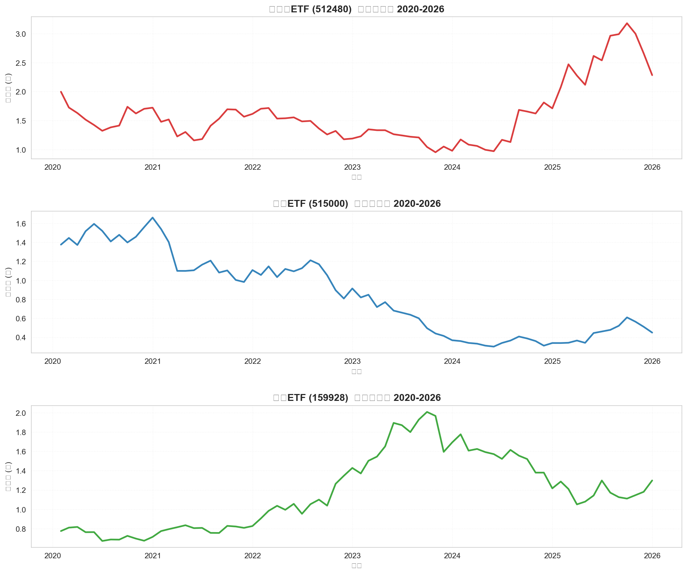
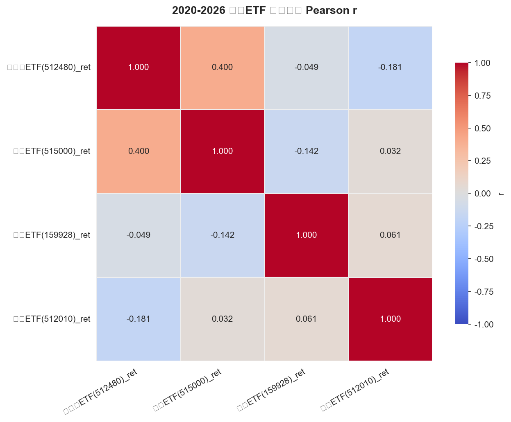
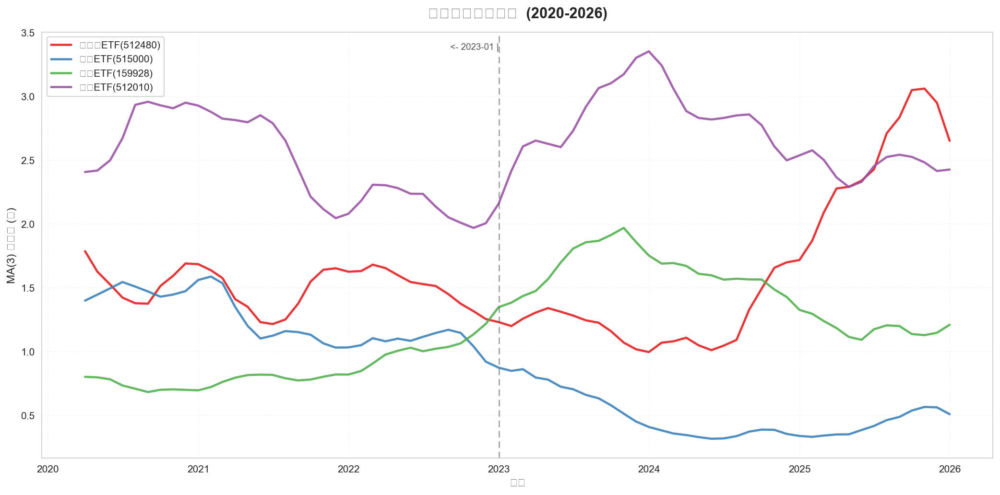
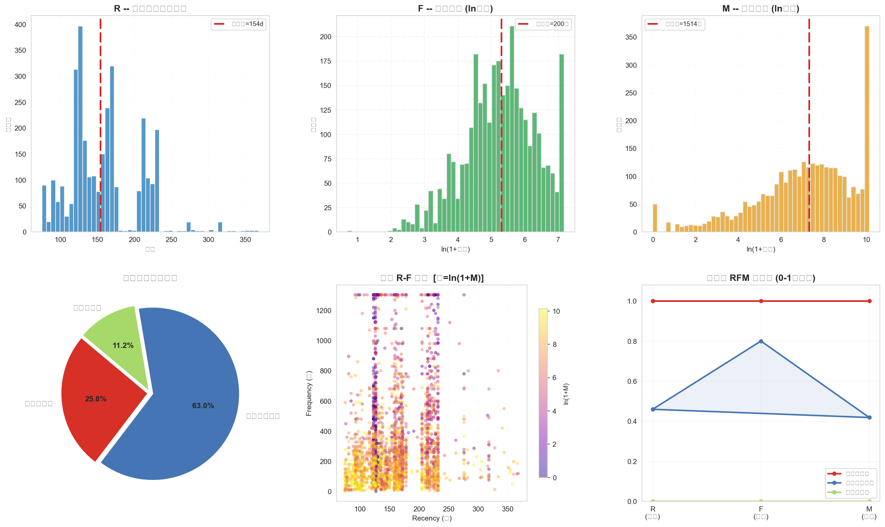

# 金融大数据课程设计：行业 ETF 轮动分析与 RFM 客户价值分层

> 一份完整的金融数据分析作品集，覆盖「数据获取 → 清洗 → 计算 → 可视化 → 业务策略」全流程。
> **设计一**：基于 AkShare 拉取 A 股行业 ETF 月度数据，完成收益率、相关性与 MA(3) 趋势研判，输出行业轮动配置建议；
> **设计二**：基于 RFM 模型对美妆电商用户做价值分层，识别高价值客群并给出差异化运营策略。


---

## 项目概览

本项目围绕金融数据的两类典型问题展开，形成两条独立又互补的分析线：

| 维度 | 设计一 | 设计二 |
| ---- | ---- | ---- |
| 主题 | A 股行业轮动与 ETF 收益分析 | 用户价值分层与精细化运营 |
| 数据 | 4 只行业 ETF 月度收盘价（2020-01 ~ 2026-01） | 美妆平台销售数据（3,196 条） |
| 方法 | 收益率、皮尔逊相关、MA(3) 趋势、轮动策略 | 数据清洗、RFM 评分、可视化画像 |
| 产出 | 价格走势图 / 相关热力图 / MA3 叠加图 | 6 图综合可视化 / 分层结论 / 运营策略 |

---

## 目录结构

```
项目根目录/
├── README.md                      # 项目说明（本文件）
├── requirements.txt               # Python 依赖
├── .gitignore                     # 忽略数据与临时文件
├── data_source.md                 # 数据来源与字段说明
├── data/                          # 原始数据（不提交到 git）
├── 代码/                          # 源代码（任务模块）
│   ├── config.py                  # 全局配置（ETF 标的、数据源、绘图设置）
│   ├── 设计1任务1.py ~ 设计1任务5.py        # 设计一：5 个任务
│   └── 设计2第一部分.py ~ 设计2第三部分.py    # 设计二：预处理 / RFM / 可视化
└── outputs/
    └── figures/                   # 生成的分析图表
        ├── task1_etf_price_trends.png
        ├── task4_correlation_heatmap.png
        ├── task5_ma3_trends.png
        └── task6_rfm_visualization.png
```

---

## 设计一：行业 ETF 轮动与收益分析

### 数据与口径

- **标的**：消费 ETF（159928）、科技 ETF（515000）、半导体 ETF（512480），另有备用 ETF 医药 ETF（512010）。
- **频率与区间**：月度收盘价，2020-01 ~ 2026-01，共 72 期。
- **复权**：前复权（对 159928 的份额折算做前复权处理，消除 2024-11 的 -75% 伪跳变）。

### 任务 1：数据获取

使用 AkShare `fund_etf_hist_em` 拉取三只 ETF 的月度收盘价，记录耗时并绘制时序图：

<p align="center">
  
</p>

### 任务 2：备用 ETF 本地读写

将医药 ETF（512010）落地为 `myetf.csv` 并回读校验，验证 index / columns / 数据类型与数据质量（缺失值、重复行）。

### 任务 3：月度收益率

用 `pct_change` 计算月度收益率 `ret = (Pt − Pt−1) / |Pt−1| × 100`，首月为 NaN（无前期参照），并做手动验算与 2023 年后的均值/标准差统计。

### 任务 4：相关性分析

计算 4 只 ETF 月度收益率的皮尔逊相关系数，绘制热力图：

<p align="center">
  
</p>

> 科技 ETF 与半导体 ETF 呈较强正相关，消费 ETF 与半导体 ETF 相关性最弱，反映不同行业间的收益分化特征。

### 任务 5：MA(3) 趋势与行业轮动

对 4 只 ETF 计算 3 期移动平均，统计 2023-01 以来最长连涨/连跌月数，叠加绘制趋势图：

<p align="center">
  
</p>

| ETF | 最长连涨 | 最长连跌 | 趋势研判 |
| ---- | ---- | ---- | ---- |
| 半导体 ETF（512480） | 17 个月 | 8 个月 | 偏多（最强势） |
| 科技 ETF（515000） | 9 个月 | 15 个月 | 波动大、分歧明显 |
| 消费 ETF（159928） | 9 个月 | 10 个月 | 偏空 |
| 医药 ETF（512010） | 7 个月 | 5 个月 | 最平稳但偏弱 |

**行业轮动结论**：AI 算力需求爆发 + 国产替代战略双驱动，半导体/科技趋势偏强；医药受集采政策压制、消费受居民消费信心拖累。建议**超配半导体与科技**（合计提至 70%）、**标配消费**（保留底仓）、**减配医药**（降至 10%），采用「三三制」分批调仓，并设置单只 ETF 15% 的回撤止损线。

---

## 设计二：RFM 模型下的客户价值分类

### 数据与口径

- **数据**：美妆平台销售数据 3,196 条 × 7 列（用户 id、商品标题、消费次数、开销总额、商品标号、店名、最近一次购买时间），覆盖 19 家店铺。
- **基准日**：2026-05-28。

### 第一部分：数据预处理

- 列名统一为英文；缺失值检查（全列无缺失）；
- 日期列转换为 `datetime64`；
- IQR 三倍四分位距异常值检测 + Winsorize 盖帽（消费次数 138 条 / 开销总额 305 条 / 商品标号 297 条）；
- 逻辑过滤（消费次数 ≤0、负金额、未来日期），保留 3,196 条有效记录。

### 第二部分：RFM 评分与分层

以基准日计算 R（近度）、F（频度）、M（金额），采用五分位数评分（R 反向、F/M 正向），`RFM 总分 = R + F + M`（3~15 分），按 `≥11 / 7~10 / ≤6` 划分为高 / 中 / 低价值：

| 层级 | 人数 | 占比 | 收入贡献 | R/F/M 均值（天 / 次 / 元） |
| ---- | ---- | ---- | ---- | ---- |
| 高价值客户 | 823 | 25.8% | **45.7%** | 120 / 375.6 / 9,758 |
| 中等价值客户 | 2,014 | 63.0% | 52.5% | 166 / 328.6 / 4,580 |
| 低价值客户 | 359 | 11.2% | 1.7% | 205 / 140.5 / 855 |

### 第三部分：可视化

6 张综合分析图（R/F/M 分布直方图、价值层级饼图、R-F 散点、RFM 雷达图）：

<p align="center">
  
</p>

### 运营策略

- **高价值客户 — VIP 维护**：专属会员体系、1 对 1 客服、新品优先购、积分兑换，维护品牌粘性与复购率；
- **中等价值客户 — 提升转化**：个性化推荐、阶梯满减券（满 200 减 30）、买二送一、消费目标奖励，推动向高价值转化；
- **低价值客户 — 唤醒激活**：「回归有礼」大额券、季节护理提醒、流失原因调研、低门槛试用，重建购买习惯。

---

## 技术栈

| 环节 | 技术 / 方法 |
| ---- | ---- |
| 数据获取 | AkShare `fund_etf_hist_em`、本地 Excel 回读 |
| 数据处理 | Pandas（清洗、`pct_change`、`rolling`、`groupby`、`qcut`） |
| 可视化 | Matplotlib + Seaborn（时序图、热力图、直方图、饼图、散点、雷达图） |
| 分析方法 | 移动平均 MA(3)、皮尔逊相关、RFM 价值分层、Winsorize 异常值处理 |

---

## 核心结论

1. **行业轮动**：半导体 ETF 趋势最强（最长连涨 17 个月），医药 ETF 最平稳但受集采压制；科技与半导体高度正相关，可打包配置。
2. **用户价值**：高价值客户以 25.8% 的人数贡献 45.7% 的收入，是核心利润支柱；中等价值客户是最大的增长潜力池（63.0%）。
3. **策略落地**：从「分群 → 画像 → 差异化运营」形成可执行的精细化运营闭环。

---

## 复现方式

```bash
# 1. 安装依赖
pip install -r requirements.txt

# 2. 准备数据
#    - ETF 数据：由 AkShare 在线获取（见 config.py 配置），或使用 data/etf_*.xlsx 本地数据
#    - 用户数据：将「橙色桃子用户数据.xlsx」放入 data/ 目录

# 3. 依次运行 代码/ 下的任务脚本
#    设计一：设计1任务1.py → 设计1任务2.py → … → 设计1任务5.py
#    设计二：设计2第一部分.py → 设计2第二部分.py → 设计2第三部分.py
```

> 各任务脚本内封装为 `run()` / `download_and_plot()` / `correlate()` / `visualize()` 等函数，可通过统一入口按序调用。

---

## 项目亮点

1. **完整闭环**：从取数、清洗、计算、可视化到业务策略，覆盖数据分析全流程；
2. **指标严谨**：收益率公式、空值校验、IQR 异常值处理、前复权消除折算跳变，均有据可查；
3. **可视化规范**：统一中文字体、配色与图表风格，6 图综合呈现 RFM 画像；
4. **策略可落地**：行业轮动与客户分层均落到具体配置比例 / 运营动作，而非止步于描述。

---

## 局限与展望

- ETF 分析为月度低频数据，未纳入成交量、换手率等量价因子，趋势研判偏技术面；
- RFM 为静态截面分层，未建模客户价值的时间迁移；后续可引入 K-Means 聚类与流失预测（如 XGBoost）；
- 运营策略中的券面额、转化率为经验假设，落地需通过 A/B 测试实测回填。

---

## 数据来源与声明

- ETF 数据来自 AkShare（东方财富接口），用户数据为课程提供的脱敏样例数据；
- 本仓库不包含原始数据与任何个人身份信息，仅用于学习与作品集展示。
